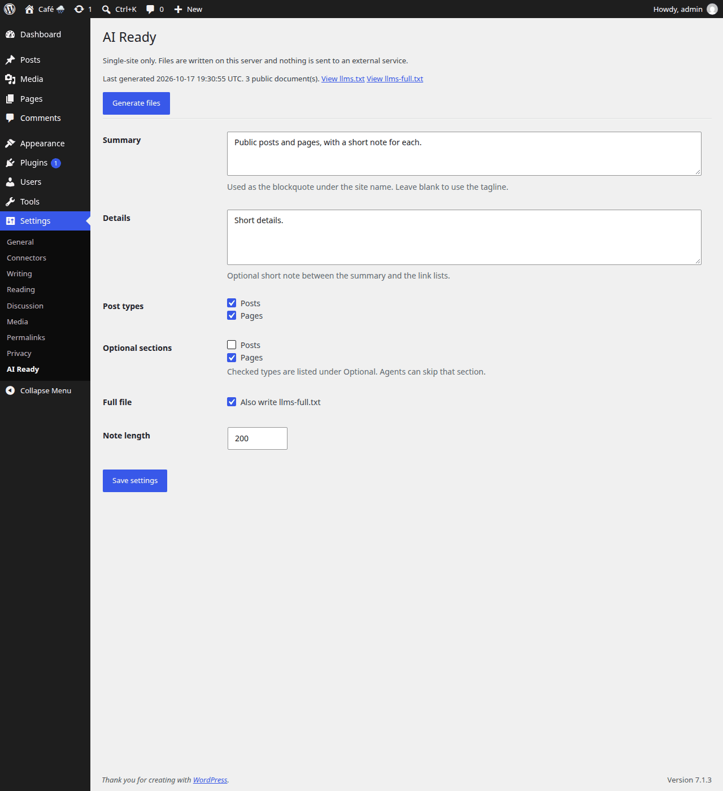

[](https://github.com/fmarcano14/ai-ready-wp/actions/workflows/ci.yml)

# AI Ready WP

AI Ready WP is a single-site WordPress plugin. It writes `/llms.txt` for the public site, an optional `/llms-full.txt`, and a Markdown view of each included post or page. Everything is generated on the server. Nothing is sent to an external service.



## Install

1. Copy this directory to `wp-content/plugins/ai-ready-wp`. PHP 7.4 or newer and the mbstring extension are required. If mbstring is missing, the plugin shows an admin notice and does not load.
2. Activate **AI Ready WP** on a single site. It does not run on multisite.
3. Open **Settings > AI Ready** and press **Generate files**.

Pretty permalinks produce `/sample-post.md`. Plain permalinks produce `?format=markdown` on that post. Both responses are `text/markdown; charset=utf-8`.

## Usage

- **Settings > AI Ready** chooses the summary, the optional details, which public post types are included, which of those belong under Optional, whether to publish `llms-full.txt`, and the note length. A rebuild includes at most 499,950 documents.
- On each post or page, **Exclude from AI files** leaves that document out. A noindex flag from Yoast, Rank Math, SEOPress, All in One SEO, or The SEO Framework does the same.
- `wp ai-ready generate` rebuilds the files. `wp ai-ready status` prints whether they exist.
- Saving a public post schedules one rebuild 30 seconds later. Unpublishing, adding a password, excluding a document, or marking it noindex updates the files in that same request.
- Deleting the plugin removes its settings, the exclude flag, the scheduled rebuild, and the generated files.

`llms.txt` and each document's Markdown are stored in the database. `llms-full.txt` is not stored: the plugin streams it from those documents when someone requests it, and sends an ETag so an unchanged copy can answer 304. Nothing is a file under uploads. The public URLs are `/llms.txt`, `/llms-full.txt`, and the Markdown views.

## Sample llms.txt

```text
# Northwind Kitchen

> Recipes and notes from a small bakery in Portland.

One new recipe each week. Older posts stay in the archive.

## Posts

- [Rye starter, day four](https://example.com/rye-starter.md): How the levain smells when it is ready to bake.
- [Saturday bread schedule](https://example.com/saturday-bread.md): Oven times for the weekend bake.

## Optional

- [Allergen chart](https://example.com/allergen-chart.md): Flour, nuts, and dairy for each loaf.
```

## Design

Inclusion, notes, and the llms.txt builder are pure PHP and do not load WordPress.
The plugin reads posts in batches, stores llms.txt and each Markdown document in the database, and streams llms-full.txt from that stored Markdown.
Visitors never trigger a rebuild: edits wait on one cron event, and unpublishing, a password, or an exclude flag rewrites the files in that request.

## License

GPL-2.0-or-later. See [LICENSE](LICENSE).
