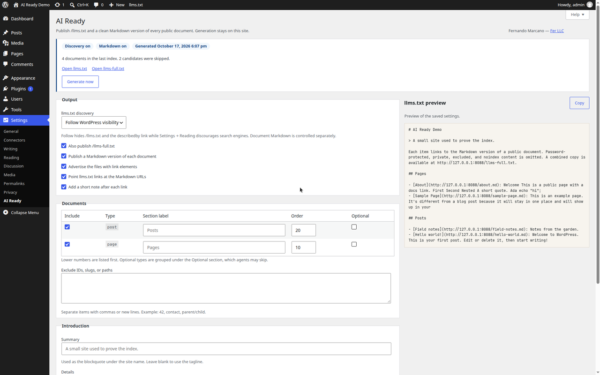

# AI Ready WP

AI Ready WP makes a WordPress site readable by AI assistants from inside wp-admin. It publishes a spec-shaped [`/llms.txt`](https://llmstxt.org/) index and a clean Markdown version of every public document. Nothing leaves the site: there is no external API, no account, and no background service beyond WP-Cron.

Fernando Marcano, [Fer LLC](https://fer.marketing)



## What it publishes

| URL | What it is |
| --- | --- |
| `/llms.txt` | H1 site name, a blockquote summary, optional details, then H2 sections of Markdown links. |
| `/llms-full.txt` | The same introduction followed by each document's Markdown, separated by horizontal rules. Optional. |
| `/about.md` | Markdown for the page whose permalink is `/about/`. The front page is `/index.md`. |
| `?format=markdown` | The same Markdown document when the site uses plain permalinks (`?p=123&format=markdown`). |

On a singular public document the plugin adds:

```html
<link rel="describedby" href="https://example.com/llms.txt" />
<link rel="alternate" type="text/markdown" href="https://example.com/about.md" title="Markdown version" />
```

`/llms.txt` follows the [llms.txt](https://llmstxt.org/) shape: one H1, a blockquote summary, free-form details that are not headings, then H2 sections whose items are `- [name](url): notes`. Types marked **Optional** are grouped under a section titled `Optional`. That word is a convention in the spec, so it stays in English.

## Why the defaults are conservative

The index lists only content a visitor can already read.

- The post must be published, public, and of a selected post type.
- Password-protected and private content is omitted.
- A per-document **AI Ready** meta box can exclude one item.
- Settings can exclude IDs, slugs, or paths (`42`, `contact`, `parent/child`).
- A noindex flag from Yoast, Rank Math, SEOPress, All in One SEO, or The SEO Framework keeps the document out. The plugin also honors its own `_ai_ready_wp_noindex` meta.
- WooCommerce cart, checkout, and account pages, and the posts page, are structural pages and are not listed.
- Discovery follows **Settings → Reading**. While search engines are discouraged, `/llms.txt`, `/llms-full.txt`, and the `describedby` link stay off. Markdown URLs are a separate switch.

When discovery is off, generation still builds the text for the settings preview and for `wp ai-ready generate --stdout`, then deletes the public index files under `uploads/ai-ready-wp/` so a direct file URL cannot keep serving them.

## Requirements

- WordPress 6.2 or newer (tested on 7.1)
- PHP 7.4 through 8.3
- Pretty permalinks are recommended. Plain permalinks still serve `?format=markdown` and any request that reaches WordPress.

## Install

1. Copy this directory to `wp-content/plugins/ai-ready-wp`, or install the release zip.
2. Activate **AI Ready WP**. Activation registers the rewrite rules and flushes them.
3. Open **Settings → AI Ready** and choose **Generate now**.

`composer install` is only needed for development. The plugin ships a small autoloader, so a site does not need Composer.

## Usage

**Settings → AI Ready** controls:

- Discovery: follow WordPress visibility, always publish, or disable.
- `/llms-full.txt`, per-document Markdown, `<link>` elements, Markdown targets inside `llms.txt`, and the short note after each link.
- Which public post types are included, their section label, their order, and whether they belong under `Optional`.
- A custom summary (blank uses the tagline) and details (blank uses a short built-in explanation).
- Caps for the index, the full file, and the cache lifetime.

The preview on the right updates from the unsaved form. It does not write the cache. **Generate now** writes it immediately.

Each supported document has an **AI Ready** box in the sidebar. Checking **Exclude from AI Ready** drops that document from the index and from its Markdown URL. Quick Edit does not clear the flag, because that save does not include the meta box nonce.

Saving a document, changing exclusion or robots meta, or saving settings drops the cached index immediately and schedules one rebuild. The default delay is 60 seconds (`ai_ready_wp_debounce_seconds`, clamped between 15 seconds and one hour). WP-Cron runs the rebuild, so a quiet site needs a visitor or a system cron hitting `wp-cron.php`.

### WP-CLI

```bash
wp ai-ready generate
wp ai-ready generate --stdout
wp ai-ready status
```

## Caching

Generated files live in two places:

- Transients keyed by blog ID (`ai_ready_wp_llms_{blog}`, `ai_ready_wp_full_{blog}`, `ai_ready_wp_md_{blog}_{post}`).
- `wp-content/uploads/ai-ready-wp/llms.txt` and `llms-full.txt`, used when the transient is cold.

A request for a missing index regenerates it under a lock. A second request during that work receives `503` and `Retry-After: 10`. Unpublishing or excluding a document deletes its transient and the index files in the same request, so a stale copy is not served while cron waits. Markdown responses send `X-Robots-Tag: noindex`. The index sends `X-Robots-Tag: all` when discovery is on.

## Hooks

| Hook | Role |
| --- | --- |
| `ai_ready_wp_capability` | Capability for the settings screen. Default `manage_options`. |
| `ai_ready_wp_post_types` | Public post types offered in settings. |
| `ai_ready_wp_post_is_public` | Return false to hide a document from Markdown. Cannot force an ineligible document in. |
| `ai_ready_wp_post_is_discoverable` | Return false to omit a document from `llms.txt`. |
| `ai_ready_wp_sections` | Adjust the section list before it is rendered. |
| `ai_ready_wp_rendered_html` | HTML after `the_content`, before conversion. |
| `ai_ready_wp_markdown` | Markdown for one document, sanitized again after the filter. |
| `ai_ready_wp_llms_txt` | Finished `llms.txt`, sanitized again after the filter. |
| `ai_ready_wp_llms_full` | Finished `llms-full.txt`, sanitized again after the filter. |
| `ai_ready_wp_cache_ttl` | Cache lifetime in seconds. |
| `ai_ready_wp_debounce_seconds` | Delay before the cron rebuild. |
| `ai_ready_wp_generated` | Action after a successful generation. |

## Development

See [DEVELOPMENT.md](DEVELOPMENT.md) for layout, the test commands, and wp-env.

```bash
composer install
composer check
```

## FAQ

**Does this call an AI vendor?**
No. Conversion and indexing run in PHP on the site.

**Will this change robots.txt or the sitemap?**
No. Discovery only adds `llms.txt` and a `describedby` link. It does not edit robots.txt.

**What happens on a multisite network?**
Each site has its own settings, cache keys, and uploads directory. Uninstall cleans every site.

**Why is a page missing?**
Check that it is published, not password protected, not noindexed, not excluded, and that its post type is selected. The posts page and WooCommerce account pages are always skipped.

## Roadmap

- A robots.txt hint for `/llms.txt` when discovery is on.
- Broader noindex detection for plugins that store robots data outside post meta.
- A REST representation of the same Markdown for headless front ends.

## License

[GPL-2.0-or-later](LICENSE).
